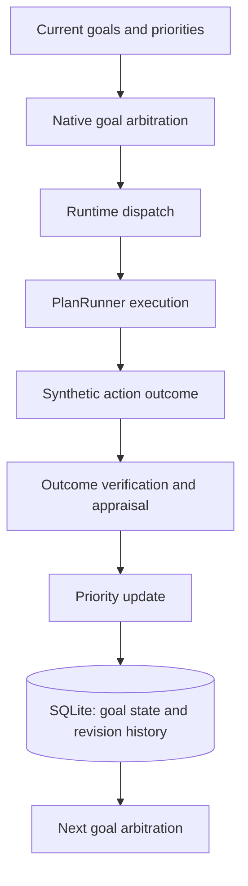
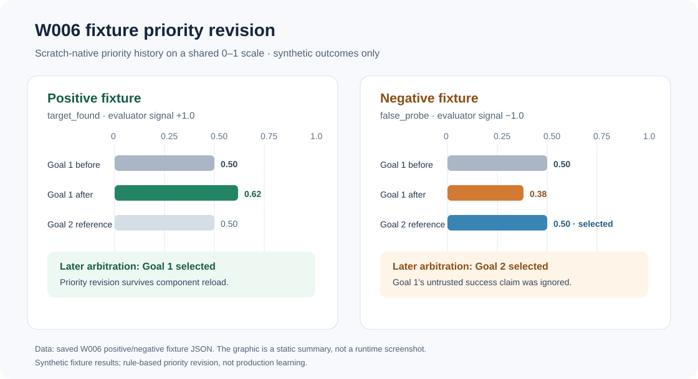

# aria-native-learning-benchmark
An AI research experiment exploring native decision-making, consequence-based feedback, and persistent goal adaptation within ARIA's cognitive architecture

## Project Overview

This experiment is exploring how ARIA can make decisions on it's own, learn from failure, and it's behavioral adaptation through experience. The project
tests ARIA's native decision-making framework, focusing on how it's actions and their outcomes change future priorities without relying on a LLM to
do so.

The initial controlled tests demonstrate persistent, feedback driven goal adaptation. Ongoing tests aim to determine if these mechanisms produce measurable
improvements in autonomy, learning, & generalization.

**The goal is to measure genuine adaptive intelligence through observable evidence rather than simulation it's intelligence through prompting or conversation.**

## Architecture

W006 demonstrates a controlled feedback pathway connecting native goal selection, action execution, verified synthetic consequences, and continuous priority adaptation.

The following diagram illustrates the decision and feedback pathway tested during W006:

W006 verified this pathway by using controlled, synthetic scenarios. The resulting priority changes were persisted and used during subsequent arbitration. 

This does not yet establish general learning improvement or production-level autonomous cognition.

## W006 Experiment Results

- Two controlled scenarios were tested:

Positive outcome: A successful synthetic action increased the selected goal's priority from 0.50 to 0.62.
Negative outcome: A failed synthetic action decreased the selected goal's priority from 0.50 to 0.38, after which the system changed goals.

The W006 test suite reports 33/33 PASSING CHECKS... with 0 generative model calls during the tested decision selections.

These controlled experiments show how verified synthetic action outcomes can change ARIA's persistent goal priorities and subsequent decisions.
Demonstrating a functioning consequence-driven priority mechanism, not yet a measured improvement in general problem solving ability.

## Research Status 

W006 is a verified, scratch-only engineering milestone in ARIA's development.

Future experiments will show authentic runtime feedback, measurable learning advantages, long-term retention, and generalization across unfamiliar
environments.

*ARIA remains as experimental, research architecture. AGI and RSI are long-term research objectives, not established capabilities*
