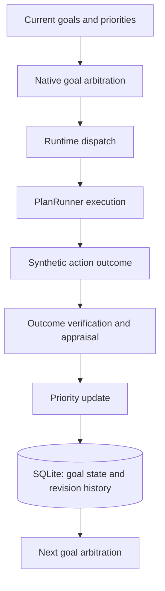

#                                      aria-native-learning-benchmark
An AI research experiment exploring native decision-making, consequence-based feedback, and persistent goal adaptation within ARIA's cognitive framework

##                                            Project Overview

This experiment is exploring how ARIA can make decisions on it's own, learn from failure, and it's behavioral adaptation through experience. The project
tests ARIA's native decision-making framework, focusing on how it's actions and their outcomes change future priorities without relying on a LLM to
do so.

The initial controlled tests demonstrate persistent, feedback driven goal adaptation. Ongoing tests aim to determine if these mechanisms produce measurable
improvements in autonomy, learning, & generalization.

**To put it simply, the goal is to measure genuine adaptive intelligence through evidence, not a simulation of intelligence through conversation.**

##                                              Architecture

W006 (current stage) demonstrates a controlled feedback pathway connecting native goal selection, action execution, verified synthetic consequences, and 
continuous priority adaptation.

The following diagram illustrates the decision and feedback pathway tested during W006.

W006 verified this pathway by using controlled, synthetic scenarios. The resulting priority changes were persisted and used during subsequent arbitration. 

This does not yet establish general learning improvement or production-level autonomous cognition.

